# Awesome Container Security Software 🛡️📦

<div align="center">



<br/>
<br/>

<a href="https://github.com/ishandutta2007/Awesome-Awesome-Awesome"></a><a href="https://discord.gg/jc4xtF58Ve"></a>
[](https://opensource.org/licenses/MIT)
[](https://github.com/ishandutta2007/Awesome-Container-Security-Software)
[](https://github.com/ishandutta2007/Awesome-Container-Security-Software/blob/main/CONTRIBUTING.md)
<a href="https://github.com/ishandutta2007"></a>

<br/>
<br/>

**A curated, production-grade directory of Container Security Platforms, Vulnerability Scanners, Kubernetes Policy Engines, eBPF Runtime Threat Detectors, and Supply Chain Defense Tooling.** 🌟 *Star if you find it helpful!* 🌟

</div>

---

## 📑 Table of Contents

- [📊 Sector Overview & Market Dynamics](#-sector-overview--market-dynamics)
- [☁️ SaaS & Enterprise Hosted Platforms](#-saas--enterprise-hosted-platforms)
- [🔓 Open-Source GitHub Projects](#-open-source-github-projects)
  - [⭐ Ranked by GitHub_Stars](#-ranked-by-github-stars)
  - [🧩 Recommended Architecture Patterns](#-recommended-architecture-patterns)
- [📈 Star History](#-star-history)
- [🤝 How to Contribute](#-how-to-contribute)
- [💖 Support & Sponsorship](#-support--sponsorship)
- [⚠️ Disclaimer](#️-disclaimer)

---

## 📊 Sector Overview & Market Dynamics

The global container security and cloud workload protection market is estimated at **$3.6B–$3.9B in 2026** (scaling within the broader **$5.7B–$9.2B** CWPP sector at a ~20–25% CAGR), driven by enterprise Kubernetes adoption, microservices expansion, and compliance mandates (e.g., NIS2, PCI-DSS 4.0 SBOM requirements).

The sector exhibits a **moderately concentrated yet bifurcated market structure**: core enterprise mindshare is dominated by mega-cap cybersecurity consolidators and CNAPP platforms (e.g., Palo Alto Networks, CrowdStrike, Wiz/Alphabet), while remaining fragmented across specialized niche domains such as eBPF-based runtime observability, software supply chain defense, and developer-centric vulnerability remediation.

---

## ☁️ SaaS & Enterprise Hosted Platforms

| Product 🏢 | Company Valuation / Revenue 💰 | Pricing (Starting Tier) 🏷️ | Free Tier / Trial Limits 🎁 | Key Capabilities & Trade-offs ⚖️ |
| :--- | :--- | :--- | :--- | :--- |
| **[GitHub Advanced Security](https://github.com/features/security)** | Parent (Microsoft): **~$3.8T–$4.0T Market Cap** / GitHub: **~$2.0B ARR** | **$49/active committer/month** ($19/mo Secret Protection + $30/mo Code Security add-ons; requires GitHub Enterprise) | **Free for public repos** (CodeQL, secret scanning & Dependabot free indefinitely); **30-day free trial** for GitHub Enterprise private evaluation | Native security integration with GitHub CI/CD, CodeQL, and secret scanning. **Trade-off**: No native deep container/IaC runtime scanner; limited to Dependabot Dockerfile `FROM` scanning. |
| **[Prisma Cloud Compute](https://www.paloaltonetworks.com/prisma/cloud)** | **~$280B–$328B Market Cap** / **$11.48B FY2026 Rev** (Palo Alto Networks) | **$180/credit/year** (~$18,000/yr for 100-credit base pack on AWS Marketplace; container hosts require 5 credits/host) | **No free tier**; **15-to-30 day guided Proof-of-Concept (PoC)** / Private Offer evaluation via sales | Comprehensive full-stack CWPP and CSPM across multi-cloud and bare-metal container hosts. **Trade-off**: Complex credit-based licensing model; enterprise-heavy deployment. |
| **[CrowdStrike Falcon Container Security](https://www.crowdstrike.com/)** | **~$260B–$270B Market Cap** / **$4.81B FY2026 Rev** (CrowdStrike Holdings) | **$1,392.99/license** (Falcon Flex list starting point on CDW; enterprise bundles custom quoted) | **No free tier**; **15-day free trial** of Falcon Cloud Security (agentless posture scanning and workload visibility without credit card upfront) | Unified agentless and agent-based kernel/runtime security integrated into the Falcon EDR ecosystem. **Trade-off**: Requires Falcon tier investment; steep learning curve for non-Falcon shops. |
| **[Wiz](https://www.wiz.io/)** | **$32B Valuation** (Acquired by Alphabet/Google) / **>$1B ARR** | **$24,000/year** (Wiz Essential starting tier for up to 100 workloads; ~$240/workload/year) | **No free tier**; **14-day free trial** with full platform access for connected cloud environments | Fast agentless discovery, multi-cloud risk graph, and rapid posture management across Kubernetes. **Trade-off**: High annual enterprise spend floors; runtime defense less deep than eBPF agent-based tooling. |
| **[JFrog Xray](https://jfrog.com/xray/)** | **~$12.2B Market Cap** / **~$532M FY2025 Rev** (JFrog Ltd.) | **$150/month** (Cloud Pro tier, 25 GB transfer/storage) or **$27,000/year** (Pro X self-hosted with Xray included) | **Free-forever community tier**: JFrog Container Registry (storage only, no Xray); **14-day full free trial** with Xray enabled (no credit card required) | Deep artifact registry integration, dependency security, and recursive SBOM analysis within Artifactory pipelines. **Trade-off**: Full Xray scanning unavailable on free/OSS tiers; advanced security requires Enterprise tiers. |
| **[Snyk Container](https://snyk.io/product/container-vulnerability-management/)** | **~$3.7B Valuation** (Private secondary) / **$309M Rev** (Snyk Ltd.) | **$25/contributing developer/month** (Team plan, 5-developer minimum = $125/month) | **Free-forever plan**: **100 container tests/month** across up to 5 active projects (unlimited users) | Actionable automated remediation with base image recommendations to bulk-eliminate CVEs. **Trade-off**: Free tier caps out rapidly in active CI/CD pipelines; credit consumption on Enterprise tier. |
| **[Sysdig Secure](https://sysdig.com/)** | **$2.5B Valuation** (Permira Series G) / **~$283M ARR** (Sysdig Inc.) | **$72/host/month** (Enterprise CNAPP starting rate on AWS Marketplace; 20-host minimum commit) | **Free OSS tier**: Falco OSS runtime engine is completely free; **30-day free trial** of Sysdig Secure platform (cloud & Kubernetes evaluation) | Built on open-source Falco with unmatched eBPF system-call observability and 100+ MITRE ATT&CK runtime policies. **Trade-off**: Requires kernel agent deployment for runtime capabilities; node-based cost scales with cluster density. |
| **[Docker Scout](https://www.docker.com/)** | **$2.1B Valuation** (Private) / **~$207M ARR** (Docker Inc.) | **$15/user/month** (Docker Team tier billed annually, or $16/mo monthly; includes unlimited Scout remote repos) | **Free-forever tier (Personal)**: **Unlimited local scans**, but strictly capped at **1–3 remote repositories** and **3 GB max image size** | Zero-friction developer ergonomics directly integrated into Docker Desktop and Docker Hub. **Trade-off**: Lightweight vulnerability scanning lacking deep runtime or admission control enforcement. |
| **[Aqua Security](https://www.aquasec.com/)** | **$1.0B Valuation** (Evolution Equity Series E) / **~$90M ARR** (Aqua Security Software) | **$35/workload/month** (Workload-based list pricing; AWS Marketplace contracts from $50,000/year) | **Free OSS tier**: Trivy CLI/scanner is free forever; **14-to-30 day free trial** of Aqua CNAPP platform on AWS Marketplace | Full-lifecycle CNAPP, Trivy-backed vulnerability intelligence, behavioral profiling, and unique vShield micro-patching in running pods. **Trade-off**: Heavy overhead and administrative overhead for smaller cluster footprints (<10 nodes). |
| **[Anchore Enterprise](https://anchore.com/)** | **~$10M–$17M Est. Revenue** / Series A funded (Anchore Inc.) | **$34,500/year** (Anchore Enterprise Cloud Image AMI on AWS Marketplace; up to 500 SBOMs/month) | **Free OSS tier**: Syft (SBOM) and Grype (scanner) are completely free; **15-day free trial** of Anchore Enterprise AMI | Industry-standard SBOM management with FedRAMP, DoD, and strict government compliance policy enforcement. **Trade-off**: Annual contract pricing tied to monthly SBOM generation volume. |

---

## 🔓 Open-Source GitHub Projects

### ⭐ Ranked by GitHub_Stars

Sorted in descending order by community adoption and GitHub Stars_Count:

#### 1. **[Trivy](https://github.com/aquasecurity/trivy)** [](https://github.com/aquasecurity/trivy/stargazers) 🛡️
- **Focus**: Multi-purpose Vulnerability, Misconfiguration, Secret, and SBOM Scanner (Apache 2.0).
- **Features**: Scans container images, filesystems, and Git repositories for CVEs in OS packages and language dependencies. Detects IaC misconfigurations (Terraform, CloudFormation, Kubernetes, Dockerfile), exposed secrets, and generates SBOMs (SPDX/CycloneDX). Runs as a single binary in CI/CD pipelines or admission controllers.
- **Trade-off**: Scanner only—no kernel-level runtime protection or system call interceptors.

#### 2. **[Cilium](https://github.com/cilium/cilium)** [](https://github.com/cilium/cilium/stargazers) ⚡
- **Focus**: eBPF-based Container Networking, Observability, and Network Security (Apache 2.0, CNCF Graduated).
- **Features**: Provides API-aware Layer 3 to Layer 7 network security policies, transparent encryption (WireGuard/IPsec), runtime identity verification, and deep observability (Hubble) for Kubernetes pods without injecting sidecars.
- **Trade-off**: Primarily focused on network and kernel-level workload traffic rather than image static analysis or SBOM generation.

#### 3. **[gVisor](https://github.com/google/gvisor)** [](https://github.com/google/gvisor/stargazers) 🧱
- **Focus**: Application Kernel for Container Isolation and Sandboxing (Apache 2.0).
- **Features**: Implements a user-space kernel (written in Go) that intercepts application system calls, creating a hardened defense boundary between untrusted containers and the host Linux kernel. Integrates cleanly with Docker, containerd, and Kubernetes as a RunC alternative runtime.
- **Trade-off**: Introduces system-call overhead on I/O-intensive workloads; does not perform vulnerability scanning.

#### 4. **[Grype](https://github.com/anchore/grype)** [](https://github.com/anchore/grype/stargazers) 🔍
- **Focus**: Vulnerability Scanner for Container Images and Filesystems (Apache 2.0).
- **Features**: Extremely fast vulnerability scanner created by Anchore. Seamlessly digests SBOMs from Syft, matches packages against regularly updated vulnerability feeds, supports multiple output formats (JSON, SARIF, CycloneDX), and integrates into automated pull request gates.
- **Trade-off**: Static scanner only—requires pairing with runtime sensors and policy admission engines.

#### 5. **[Kubescape](https://github.com/armosec/kubescape)** [](https://github.com/armosec/kubescape/stargazers) ☸️
- **Focus**: Kubernetes Security Platform, Posture Assessment & Hardening (Apache 2.0, CNCF Sandbox).
- **Features**: Automates compliance checks against CIS Benchmarks, NSA-CISA guidelines, and MITRE ATT&CK frameworks. Provides image vulnerability scanning, RBAC visualization, and eBPF-driven network policy generation.
- **Trade-off**: Broad multi-framework posture tool; runtime enforcement relies on complementary engines.

#### 6. **[Syft](https://github.com/anchore/syft)** [](https://github.com/anchore/syft/stargazers) 📦
- **Focus**: CLI Tool and Library for Generating Software Bills of Materials (SBOM) (Apache 2.0).
- **Features**: Deeply inspects container image layers, file archives, and directories to identify installed software packages, OS libraries, and nested dependencies. Emits standards-compliant SPDX, CycloneDX, and Syft-JSON formats.
- **Trade-off**: SBOM generator only—does not evaluate CVE severity directly (delegated to Grype).

#### 7. **[Docker Bench for Security](https://github.com/docker/docker-bench-security)** [](https://github.com/docker/docker-bench-security/stargazers) 📋
- **Focus**: Docker Host and Container Hardening Audit Script (Apache 2.0).
- **Features**: Portable POSIX shell script that checks for dozens of common container security best practices following the official CIS Docker Benchmark (host configuration, daemon flags, container images, runtime restrictions).
- **Trade-off**: Audit and assessment script only—no automated remediation, continuous daemon, or admission webhook.

#### 8. **[Falco](https://github.com/falcosecurity/falco)** [](https://github.com/falcosecurity/falco/stargazers) 🚨
- **Focus**: De Facto Standard Cloud-Native Runtime Threat Detection Engine (Apache 2.0, CNCF Graduated).
- **Features**: Leverages eBPF probes to intercept Linux system calls in real-time. Employs expressive YAML rules to detect anomalous behavior, container escapes, reverse shells, privilege escalations, and namespace violations with 50+ output connectors (SIEM, Slack, webhook).
- **Trade-off**: Runtime threat detection only—does not scan static container images or enforce admission gates.

#### 9. **[Kyverno](https://github.com/kyverno/kyverno)** [](https://github.com/kyverno/kyverno/stargazers) 📜
- **Focus**: Kubernetes-Native Policy Management Engine (Apache 2.0, CNCF Incubating).
- **Features**: Validates, mutates, and generates Kubernetes resources using native Custom Resource Definitions (CRDs) without requiring a specialized programming language like Rego. Enforces image signing verification with Sigstore/Cosign, image registry allowlists, and pod security standards.
- **Trade-off**: Admission and cluster mutation gatekeeper only—does not provide system call runtime monitoring.

#### 10. **[kube-bench](https://github.com/aquasecurity/kube-bench)** [](https://github.com/aquasecurity/kube-bench/stargazers) 📝
- **Focus**: CIS Kubernetes Benchmark Automation Tool (Apache 2.0).
- **Features**: Checks whether Kubernetes nodes, master components, etcd, and worker configurations conform to the CIS Kubernetes Benchmark recommendations. Can be deployed as a Kubernetes Job or run directly on master/worker hosts.
- **Trade-off**: Static configuration auditor—does not inspect live system calls or container images.

#### 11. **[Cosign](https://github.com/sigstore/cosign)** [](https://github.com/sigstore/cosign/stargazers) 🔏
- **Focus**: Container Signing, Verification, and Supply Chain Attestation (Apache 2.0, Sigstore / OpenSSF).
- **Features**: Enables keyless container signing, SBOM attestation, and signature storage directly within standard OCI registries. Integrates with Fulcio (PKI) and Rekor (transparency log) to guarantee image provenance across pipelines.
- **Trade-off**: Cryptographic signing and attestation layer—must be paired with policy admission engines (Kyverno/Gatekeeper) to enforce gates.

#### 12. **[kube-hunter](https://github.com/aquasecurity/kube-hunter)** [](https://github.com/aquasecurity/kube-hunter/stargazers) 🎯
- **Focus**: Kubernetes Penetration Testing and Vulnerability Hunting (Apache 2.0).
- **Features**: Actively scans Kubernetes clusters for open ports, misconfigured kubelet APIs, insecure etcd endpoints, and privilege escalation vulnerabilities from outside or within a compromised container.
- **Trade-off**: Active reconnaissance tool—designed for security assessments rather than passive continuous defense.

#### 13. **[Tracee](https://github.com/aquasecurity/tracee)** [](https://github.com/aquasecurity/tracee/stargazers) 🕵️
- **Focus**: eBPF-Powered Runtime Security and Forensics Sensor (Apache 2.0).
- **Features**: Collects kernel events at high speed using eBPF to detect suspicious behavioral patterns (memory injection, unauthorized syscall execution, fileless execution). Emits rich forensic metadata for SOC and threat investigation.
- **Trade-off**: Sensor and detection engine—requires integration with SIEMs or alerting backends for automated orchestration.

#### 14. **[Gatekeeper](https://github.com/open-policy-agent/gatekeeper)** [](https://github.com/open-policy-agent/gatekeeper/stargazers) 🏛️
- **Focus**: Policy Controller for Kubernetes using Open Policy Agent (OPA) (Apache 2.0, CNCF Graduated).
- **Features**: Enforces fine-grained admission policies written in Rego. Audits existing cluster resources against compliance rules, supports constraint templates, and blocks non-compliant container configurations before deployment.
- **Trade-off**: Requires learning OPA Rego policy language; requires custom webhook operational management.

#### 15. **[Polaris](https://github.com/fairwindsops/polaris)** [](https://github.com/fairwindsops/polaris/stargazers) 🧭
- **Focus**: Kubernetes Deployment Best Practices and Security Validation (Apache 2.0).
- **Features**: Audits Kubernetes workload definitions for security gaps (privilege escalation, missing resource limits, host port bindings, read-only root filesystems). Operates as a CLI, webhook admission controller, or web dashboard.
- **Trade-off**: Focuses on resource manifest sanity and configuration rather than container binary or runtime analysis.

#### 16. **[Dockle](https://github.com/goodwithtech/dockle)** [](https://github.com/goodwithtech/dockle/stargazers) 🔬
- **Focus**: Container Image Linter for Security and Best Practices (Apache 2.0).
- **Features**: Analyzes Docker images for insecure instructions (root user execution, leaked credentials, suspicious files, unneeded setuid permissions) without executing the container or requiring a Docker daemon.
- **Trade-off**: Linter for image construction hygiene; not a CVE vulnerability database scanner.

#### 17. **[KubeArmor](https://github.com/kubearmor/KubeArmor)** [](https://github.com/kubearmor/KubeArmor/stargazers) 🛡️
- **Focus**: LSM-based Runtime Policy Enforcement and Least-Privilege Isolation (Apache 2.0, CNCF Sandbox).
- **Features**: Utilizes Linux Security Modules (AppArmor, SELinux, BPF-LSM) to actively enforce and block prohibited file access, binary execution, and network connections in running pods at the kernel layer.
- **Trade-off**: Hard enforcement tool—does not maintain a vulnerability database or generate SBOMs.

#### 18. **[NeuVector](https://github.com/neuvector/neuvector)** [](https://github.com/neuvector/neuvector/stargazers) 🌐
- **Focus**: End-to-End Open-Source Container Security and Container Network Firewall (Apache 2.0, SUSE).
- **Features**: Complete zero-trust security platform with Layer 7 container firewall, packet inspection, CIS benchmark auditing, vulnerability scanning, and behavioral admission controls.
- **Trade-off**: Heavier infrastructure footprint compared to modular single-purpose CLI utilities.

#### 19. **[dsecrat (docker-security)](https://pkg.go.dev/github.com/Ratnadeepdeyroy/docker-security)** [](https://pkg.go.dev/github.com/Ratnadeepdeyroy/docker-security) ⚙️
- **Focus**: All-in-One Offline Container Security Engine in Go.
- **Features**: Integrates 18 security capabilities in a single portable binary—SBOM, CVE scanning, secret detection, CIS/NIST compliance, Docker authorization plugin, admission webhook, and eBPF runtime sensor with embedded offline databases.
- **Trade-off**: Newer project; runtime sensor is Linux-only.

---

### 🧩 Recommended Architecture Patterns

To achieve comprehensive protection using open-source tools without vendor lock-in, modern engineering teams compose the following layered defense-in-depth stack:

```
┌───────────────────────────────────────────────────────────────┐
│ 1. Shift-Left & CI/CD Pipeline                                │
│    ├── Trivy / Grype (Vulnerability & Secret Scanning)        │
│    ├── Syft (SBOM Generation: SPDX / CycloneDX)               │
│    └── Cosign (Image Signing & Attestation)                   │
├───────────────────────────────────────────────────────────────┤
│ 2. Admission Control & Policy Gate                            │
│    ├── Kyverno / Gatekeeper (Signature & Policy Verification) │
│    └── Polaris (Resource & Security Context Hygiene)          │
├───────────────────────────────────────────────────────────────┤
│ 3. Kernel Isolation & Runtime Hardening                       │
│    ├── gVisor (Untrusted Workload Application Kernel Sandbox) │
│    └── KubeArmor (LSM-based Process & File Restriction)       │
├───────────────────────────────────────────────────────────────┤
│ 4. Runtime Threat Detection & Network Defense                 │
│    ├── Falco / Tracee (eBPF Real-Time Threat Alerts)          │
│    └── Cilium (eBPF L3–L7 Container Network Policy & WAF)     │
└───────────────────────────────────────────────────────────────┘
```

---

## 📈 Star History

[](https://star-history.dera.page/#ishandutta2007/Awesome-Container-Security-Software&type=date&legend=top-left)

---

## 🤝 How to Contribute

Contributions are warmly welcome! To propose a new software entry or update an existing platform:

1. **Fork** the repository. 🍴
2. **Add / Edit** entries in `README.md` following the established table or markdown format. ✏️
3. Include: Product name, official link, 1–2 sentence description, licensing model, and key trade-offs. 📝
4. Submit a **Pull Request (PR)** with a clear title and brief rationale. 🚀

---

## 💖 Support & Sponsorship

Thank you for exploring and utilizing **Awesome Container Security Software**! 🙏

If you find this repository valuable for your security team, platform architecture, or research, please consider:
- ⭐ **Starring** the repository on GitHub to boost visibility.
- 🍴 **Forking** and contributing missing tools or updated pricing benchmarks.
- 📢 **Sharing** this guide with colleagues, DevOps communities, and security channels.
- ☕ **Sponsoring the project**: Buy us a coffee or support ongoing maintenance via the [GitHub Sponsor Dashboard](https://github.com/sponsors/ishandutta2007)!

---

## ⚠️ Disclaimer

- This is an **independent community-curated reference** — not an endorsement of any commercial platform or open-source tool.
- Container security platforms handling image registries and runtime telemetry must comply with applicable data protection regulations (GDPR, CCPA, etc.) and enforce least-privilege RBAC.
- **Capability Separation**: Image scanners (*Trivy, Grype*) find static flaws prior to deployment; admission engines (*Kyverno, Gatekeeper*) enforce governance at the cluster gate; sandboxes (*gVisor*) isolate processes; runtime sensors (*Falco, Tracee, Cilium, KubeArmor*) detect and thwart active in-pod compromises.
- Ensure all open-source and commercial agent deployments undergo strict testing before rolling out to mission-critical production Kubernetes clusters.

---

<div align="center">
<b>Crafted for DevSecOps engineers, platform security teams, and cloud architects building resilient container environments.</b> 🛡️
</div>
